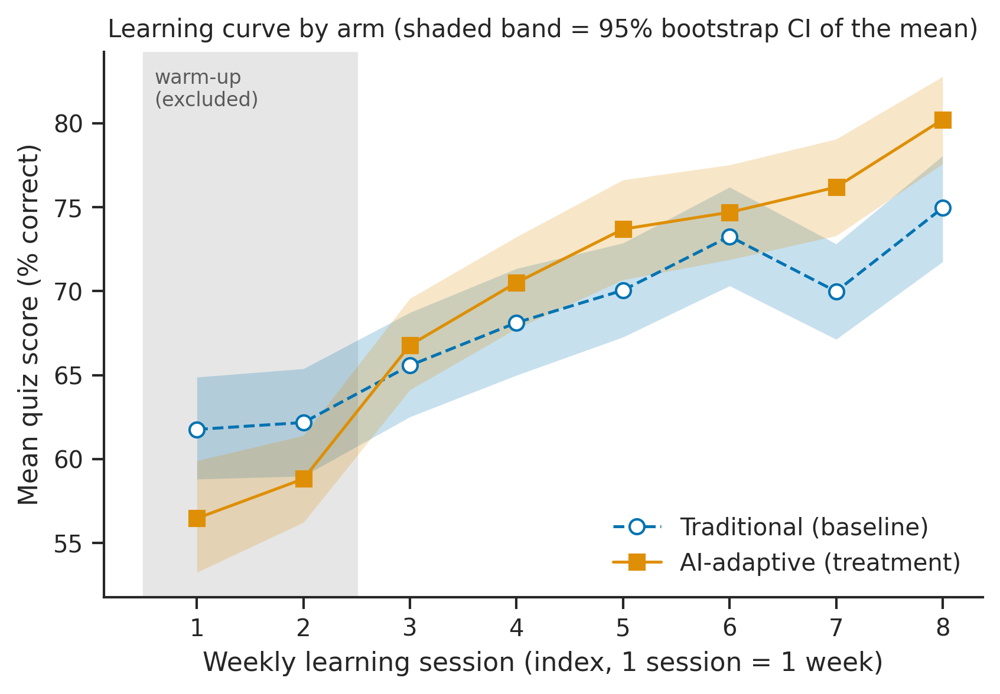
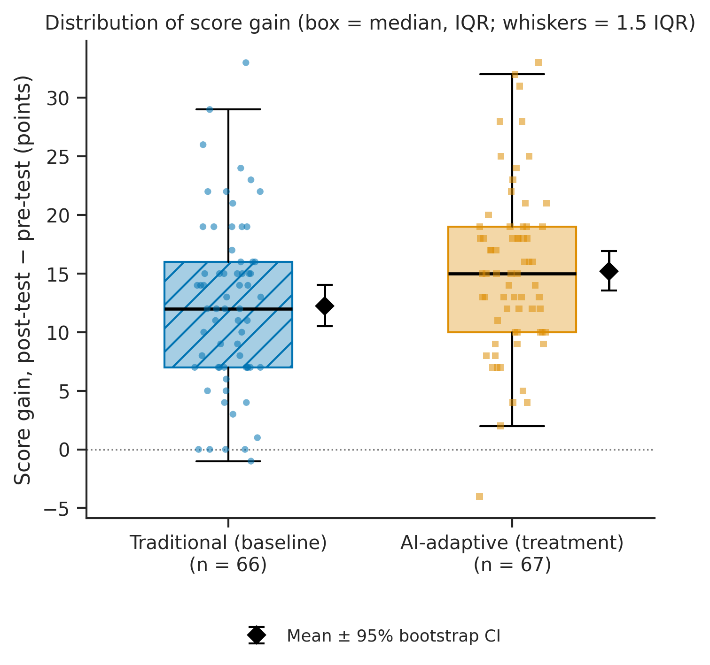
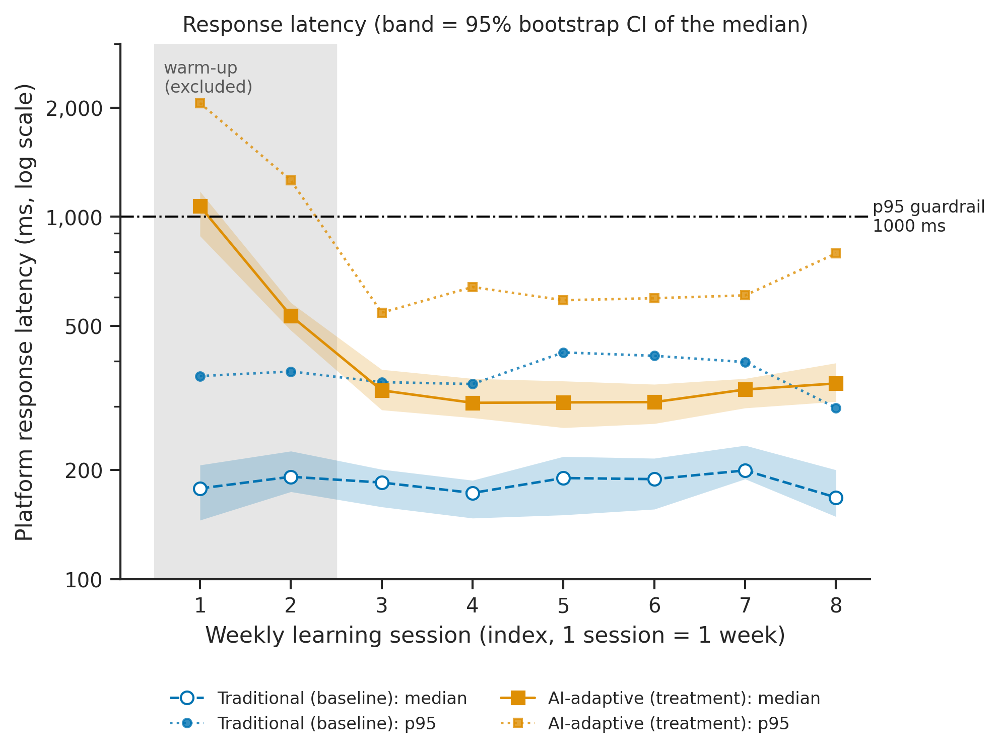

# Evaluating AI-Based Adaptive Learning in Higher Education

**Authors:** Nurali Seifulla · Nurbakyt Sagidulla — Narxoz University
**Study design:** two-arm parallel-group randomized controlled trial (RCT)
**Status:** analysis pipeline complete and tested on a **simulated** session log (see [Data status](#data-status))
**License:** MIT

## Overview

Does learning with an AI-adaptive platform raise university students' test scores more than
traditional learning does? This repository contains the methodology, a reproducible analysis
pipeline (raw JSONL log → warm-up filtering → bootstrap statistics → publication-quality figures),
an executed Jupyter notebook and a formal domain model.

- Methodology card: [`docs/methodology_card.md`](docs/methodology_card.md)
- Domain model (LaTeX loss and metric definitions): [`docs/domain_model.md`](docs/domain_model.md)
- Analysis notebook: [`notebooks/01_data_analysis.ipynb`](notebooks/01_data_analysis.ipynb)

## Research question and hypotheses

**RQ1.** How does learning with an AI-based adaptive platform affect university students' score
gain and time on task compared with traditional learning on equivalent material?

- **H₀:** mean score gain (post-test − pre-test) is equal in both arms.
- **H₁:** mean score gain differs between arms (expected: adaptive > traditional).
- **Decision rule:** reject H₀ if the two-sided Welch t-test gives p < 0.05 **and** the 95% bootstrap CI
  of the difference excludes 0. Sensitivity: ANCOVA `posttest ~ arm + pretest`.

| Variable type | Variable | Unit |
|---|---|---|
| Independent | Learning approach: `traditional` (baseline) vs `adaptive` | – |
| Dependent, primary | Score gain = post-test − pre-test | points |
| Dependent, secondary | Time on task per session; weekly quiz score | min; % |
| Controlled | Pre-test (stratified randomization), content, item bank, schedule, software versions, seed | – |
| Guardrails | Error rate ≤ 2%, p95 latency ≤ 1000 ms, attrition ≤ 15% | %, ms |

## Repository structure

```text
research-methods/
├── configs/config.yaml              # all experiment parameters (paths, seed, warm-up, thresholds)
├── data/
│   ├── sample/student_results.csv   # 10-row smoke-test sample (Task 2)
│   ├── raw/test_run.jsonl           # raw session log: pretest, 8 sessions (warm-up + evaluation), posttest
│   └── processed/                   # metrics_summary.csv, student_outcomes.csv, session_curve.csv,
│                                    # guardrails.csv, inferential_tests.json
├── docs/
│   ├── methodology_card.md          # research passport (design, variables, metrics, threats)
│   └── domain_model.md              # LaTeX loss / metric formalisation + metric collection points
├── notebooks/01_data_analysis.ipynb # executed end-to-end, outputs saved
├── reports/figures/                 # fig1–fig3 as .pdf (vector) and .png (300 dpi)
├── src/
│   ├── benchmark.py                 # Task 2 smoke test on the sample
│   ├── simulate_data.py             # seeded generator of the simulated raw log
│   ├── process_data.py              # warm-up filter, guardrails, bootstrap CIs, hypothesis tests
│   └── visualize.py                 # figure generation (colour-blind safe, units, CIs)
├── Dockerfile · requirements.txt · LICENSE · .gitignore · .dockerignore
└── README.md
```

## System requirements

- Python 3.11 (tested with 3.11.11 / 3.11.18); all packages pinned in `requirements.txt`
- Or Docker (base image `python:3.11.11-slim`)
- Any OS; no GPU; < 1 minute run time

## Quickstart

From the repository root:

```bash
python -m pip install -r requirements.txt
python src/process_data.py && python src/visualize.py
```

This reads `data/raw/test_run.jsonl`, writes `data/processed/*.csv|json` and
`reports/figures/*.pdf|png`. To re-run the notebook headlessly:

```bash
jupyter nbconvert --to notebook --execute --inplace notebooks/01_data_analysis.ipynb
```

Docker:

```bash
docker build -t adaptive-learning-benchmark .
docker run --rm -v "${PWD}/reports:/app/reports" -v "${PWD}/data/processed:/app/data/processed" adaptive-learning-benchmark
```

Task 2 smoke test on the 10-row sample: `python src/benchmark.py` → `results/summary.json`.

## Benchmark plan

| Comparison | Metric | Level | Statistic | Figure |
|---|---|---|---|---|
| Adaptive vs traditional | Score gain (points) | student | Mean ± SD, median (IQR), bootstrap 95% CI, Welch t, Hedges' g, ANCOVA | Fig. 2 |
| Adaptive vs traditional | Weekly quiz score (%) | session | Mean with bootstrap 95% CI per session | Fig. 1 |
| Adaptive vs traditional | Time on task (min/session) | student | Mean ± SD, bootstrap 95% CI, Welch t | table |
| Guardrail | Response latency (ms) | session | Median (95% CI), p95, p99 | Fig. 3 |
| Guardrail | Error rate, attrition (%) | session / student | Proportion, Wilson 95% CI | table |

## Results & Discussion

### Data status

> **The numbers below come from a simulated log** (`src/simulate_data.py`, seed 42, N = 140
> randomized, 8 weekly sessions) that has the exact format of the planned platform export. They
> demonstrate that the pipeline works. They are **not** empirical evidence; the effect size is an
> assumption built into the simulator. The real Week 7–8 log will replace `data/raw/test_run.jsonl`
> and the same commands will regenerate every table and figure.

Raw records: 1 374 · sessions: 1 101, of which 280 warm-up sessions (1–2) removed · students
analysed (complete cases): 133 (traditional 66, adaptive 67).

### Summary table (evaluation phase, sessions 3–8)

| Metric (unit) | Traditional — baseline | AI-adaptive — proposed | Δ (adaptive − baseline), 95% CI |
|---|---|---|---|
| **Score gain (points)**, mean ± SD | 12.2 ± 7.3 | 15.2 ± 7.1 | **+2.95 [0.54, 5.41]** |
| Score gain, median (p25–p75) | 12.0 (7.0–16.0) | 15.0 (10.0–19.0) | – |
| Pre-test (points), mean ± SD | 54.2 ± 9.3 | 54.4 ± 8.7 | balance check |
| Time on task (min/session), mean ± SD | 62.7 ± 4.3 | 54.4 ± 4.7 | −8.3 |
| Weekly quiz score (%), median (p25–p75) | 70.0 (61.2–78.9) | 74.0 (64.8–82.6) | – |
| Response latency (ms), median (p25–p75) | 185.9 (131.3–246.4) | 318.8 (233.1–421.7) | – |
| Response latency (ms), p95 / p99 | 399 / 466 | 621 / 871 | guardrail ≤ 1000 ✔ |
| Error rate, evaluation sessions (Wilson 95% CI) | 0.73% [0.25, 2.12] | 1.22% [0.52, 2.83] | guardrail ≤ 2% ✔ |
| Attrition (Wilson 95% CI) | 7.0% [3.1, 15.5] | 2.9% [0.8, 10.0] | guardrail ≤ 15% ✔ |

**Hypothesis test.** Welch t(130.8) = 2.36, p = 0.020; Hedges' g = 0.41; Mann–Whitney p = 0.018.
ANCOVA adjusted effect = +2.93 points, 95% CI [0.47, 5.40]. Under the decision rule H₀ would be
rejected **for this simulated dataset**.

### Figures



**Fig. 1.** Mean weekly quiz score per session with 95% bootstrap CI bands. The adaptive arm starts
below the baseline in the warm-up (cold-start) sessions and overtakes it from session 3.
[PDF](reports/figures/fig1_score_vs_session.pdf)



**Fig. 2.** Distribution of score gain by arm: box = median and IQR, points = students, diamond =
mean with 95% bootstrap CI. [PDF](reports/figures/fig2_distribution_boxplot.pdf)



**Fig. 3.** Platform response latency per session on a log scale: median with 95% bootstrap CI band and
p95 (dotted). The adaptive engine violates the 1000 ms p95 guardrail only in warm-up session 1.
[PDF](reports/figures/fig3_latency_vs_session.pdf)

### Discussion

1. **Primary metric.** The simulated adaptive arm gains about 3 points more than the baseline,
   a small-to-moderate effect (g ≈ 0.4). Randomization balanced the pre-test, so the unadjusted and
   ANCOVA estimates agree.
2. **Why warm-up filtering matters.** Including sessions 1–2 would penalise the adaptive arm for its
   cold start (lower quiz scores, ~1 s median latency in session 1) and understate the steady-state
   effect.
3. **Guardrails.** All point estimates are within thresholds. The upper Wilson bound of the adaptive
   error rate (2.8%) exceeds 2%, so on real data this guardrail needs monitoring.
4. **Limitations.** Simulated data; single course; students cannot be blinded; complete-case
   analysis assumes drop-out is unrelated to outcome. See the threats table in the methodology card.

## Domain model

The ML-track domain artifact — learner model, regularised cross-entropy loss ℒ, adaptive item
policy, estimand, Hedges' g, bootstrap CI, ANCOVA, guardrail formulas, notation table and a diagram
of the metric collection points — is in [`docs/domain_model.md`](docs/domain_model.md).

## Reproducibility

- One config file (`configs/config.yaml`) holds every parameter; seed = 42 for simulation, bootstrap
  and plot jitter. Each bootstrap step uses a fresh generator with that seed, so the CLI scripts and
  the notebook produce the same numbers.
- Exact package versions in `requirements.txt`; Docker base image pinned to a patch version.
- Invalid values stop the pipeline instead of being dropped silently.
- For the real study: ethics approval, informed consent, pseudonymised IDs, pre-registered analysis.

## Citation

```bibtex
@misc{seifulla_sagidulla_adaptive_learning_2026,
  title        = {Evaluating AI-Based Adaptive Learning in Higher Education: a Randomized Controlled Trial Pipeline},
  author       = {Seifulla, Nurali and Sagidulla, Nurbakyt},
  year         = {2026},
  howpublished = {\url{https://github.com/nurba-git/research-methods}},
  note         = {Research Methods course project, Narxoz University}
}
```

## License

MIT — see [`LICENSE`](LICENSE).
