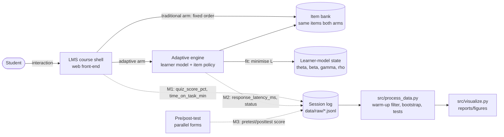

# Domain Model — Formal Specification (ML / AI track)

This document formalises (1) the learner model and loss function that an AI-adaptive platform
optimises, (2) the item-selection policy that makes it "adaptive", and (3) the study's target
metrics, hypothesis test and guardrails. A container diagram at the end shows where each metric
is collected.

> Scope note. The study treats the adaptive platform as the *intervention*; it does not train a new
> model. Section 1–2 specify the model class the platform is assumed to implement (logistic
> knowledge tracing, a standard choice in the reviewed literature), so that its parameters can be
> logged and the RQ2 extension (algorithm parameters) can be studied later.

## 0. Notation

| Symbol | Meaning | Domain / unit |
|---|---|---|
| $i \in \{1,\dots,N\}$ | student index | – |
| $j \in \{1,\dots,J\}$ | item (exercise / question) index | – |
| $k \in \{1,\dots,K\}$ | skill (knowledge component) index | – |
| $q_{jk} \in \{0,1\}$ | Q-matrix: item $j$ practises skill $k$ | binary |
| $t$ | interaction step within a student's history | – |
| $y_{ijt} \in \{0,1\}$ | observed correctness of student $i$ on item $j$ at step $t$ | binary |
| $\hat p_{ijt}$ | predicted probability of a correct answer | $[0,1]$ |
| $\theta_i$ | student ability | logit |
| $\beta_j$ | item difficulty | logit |
| $s_{ikt},\ f_{ikt}$ | prior successes / failures of student $i$ on skill $k$ before step $t$ | count |
| $\gamma_k,\ \rho_k$ | learning rate from successes / failures on skill $k$ | logit per attempt |
| $\mathbf w$ | all model parameters $(\theta,\beta,\gamma,\rho)$ | – |
| $\lambda$ | L2 regularisation strength | $\ge 0$ |
| $p^\ast$ | target success probability for item selection | $(0,1)$, default 0.70 |
| $A_i \in \{0,1\}$ | arm: 1 = adaptive, 0 = traditional (randomised) | binary |
| $X_i^{\text{pre}},\ X_i^{\text{post}}$ | pre-test and post-test score | points, $[0,100]$ |
| $\Delta_i$ | score gain | points |
| $T_{is}$ | time on task of student $i$ in session $s$ | minutes |
| $L_{is}$ | platform response latency in session $s$ | ms |
| $\mathcal S_{\text{eval}}$ | evaluation sessions $\{3,\dots,8\}$ (warm-up $\{1,2\}$ excluded) | – |

## 1. Learner model (logistic knowledge tracing)

The probability that student $i$ answers item $j$ correctly at step $t$ follows a
Performance-Factors-Analysis–style logistic model:

$$
\hat p_{ijt} \;=\; \sigma\!\Big(\theta_i - \beta_j + \sum_{k=1}^{K} q_{jk}\,\big(\gamma_k\, s_{ikt} + \rho_k\, f_{ikt}\big)\Big),
\qquad \sigma(z) = \frac{1}{1+e^{-z}} .
$$

## 2. Loss function

Parameters are fitted by minimising the regularised binary cross-entropy (negative log-likelihood)
over all logged interactions $\mathcal D = \{(i,j,t)\}$:

$$
\mathcal{L}(\mathbf w) \;=\; -\frac{1}{|\mathcal D|}\sum_{(i,j,t)\in\mathcal D}
\Big[\,y_{ijt}\log \hat p_{ijt} + (1-y_{ijt})\log\big(1-\hat p_{ijt}\big)\Big]
\;+\; \lambda\,\lVert \mathbf w \rVert_2^2 .
$$

**Cold start.** For a new student $\theta_i$ is initialised to the population mean, so early
predictions are poorly calibrated. This is why sessions 1–2 are treated as warm-up and excluded from
session-level metrics.

**Model-quality metrics** (logged by the platform, used for RQ2): AUC-ROC and the Brier score
$\mathrm{BS} = \frac{1}{|\mathcal D|}\sum (\hat p_{ijt} - y_{ijt})^2$ on a held-out time split.

### Adaptive item-selection policy

At each step the platform picks the unseen item whose predicted success probability is closest to
the target difficulty $p^\ast$ ("desirable difficulty"):

$$
j^\ast_{it} \;=\; \arg\min_{j \in \mathcal J_{\text{avail}}(i,t)} \big|\,\hat p_{ijt} - p^\ast\,\big| .
$$

The traditional arm uses a fixed item order $j = 1,2,\dots$ with the same item bank.

## 3. Target metrics of the study

**Primary outcome — score gain** for each student:

$$
\Delta_i = X_i^{\text{post}} - X_i^{\text{pre}} .
$$

**Estimand — average treatment effect** (identified by randomisation of $A_i$):

$$
\tau = \mathbb E[\Delta \mid A=1] - \mathbb E[\Delta \mid A=0],
\qquad
\hat\tau = \bar\Delta_{1} - \bar\Delta_{0}.
$$

**Effect size — Hedges' g:**

$$
g = J\,\frac{\bar\Delta_1 - \bar\Delta_0}{s_p},\qquad
s_p = \sqrt{\frac{(n_1-1)s_1^2 + (n_0-1)s_0^2}{n_1+n_0-2}},\qquad
J = 1 - \frac{3}{4(n_1+n_0)-9}.
$$

**Uncertainty — percentile bootstrap 95% CI** with $B = 10\,000$ resamples (seed 42), resampling
each arm independently:

$$
\mathrm{CI}_{95\%}(\tau) = \big[\hat\tau^{\ast}_{(0.025)},\ \hat\tau^{\ast}_{(0.975)}\big],
\qquad \hat\tau^{\ast b} = \bar\Delta_1^{\ast b} - \bar\Delta_0^{\ast b},\ b = 1,\dots,B .
$$

**Hypotheses and decision rule:**

$$
H_0:\ \tau = 0 \qquad H_1:\ \tau \neq 0 ,
$$

reject $H_0$ iff the Welch test gives $p < 0.05$ **and** $0 \notin \mathrm{CI}_{95\%}(\tau)$.

**Sensitivity model — ANCOVA:**

$$
X_i^{\text{post}} = \alpha + \tau_{\text{adj}}\,A_i + \kappa\,X_i^{\text{pre}} + \varepsilon_i,
\qquad \varepsilon_i \sim \mathcal N(0,\sigma^2).
$$

**Secondary outcome — time on task** (evaluation sessions only):

$$
\bar T_i = \frac{1}{|\mathcal S_{\text{eval}}(i)|}\sum_{s \in \mathcal S_{\text{eval}}(i)} T_{is},
\qquad
\tau_T = \mathbb E[\bar T \mid A=1] - \mathbb E[\bar T \mid A=0].
$$

## 4. Guardrail metrics

$$
\text{ErrorRate}_a = \frac{\#\{(i,s): A_i=a,\ s\in\mathcal S_{\text{eval}},\ \text{status}_{is}=\text{error}\}}
{\#\{(i,s): A_i=a,\ s\in\mathcal S_{\text{eval}}\}} \;\le\; 0.02
$$

$$
Q_{0.95}\big(\{L_{is} : A_i=a,\ s\in\mathcal S_{\text{eval}}\}\big) \;\le\; 1000\ \text{ms},
\qquad
\text{Attrition}_a = 1 - \frac{n_a^{\text{post}}}{n_a^{\text{rand}}} \;\le\; 0.15 .
$$

Error-rate and attrition CIs use the Wilson score interval.

## 5. System view with metric collection points

| Point | Metric(s) | Used for |
|---|---|---|
| M1 | `quiz_score_pct`, `time_on_task_min` | learning curve, secondary outcome |
| M2 | `response_latency_ms`, `status` | latency and error-rate guardrails |
| M3 | `score` for `pretest` / `posttest` events | primary outcome $\Delta_i$, attrition |
